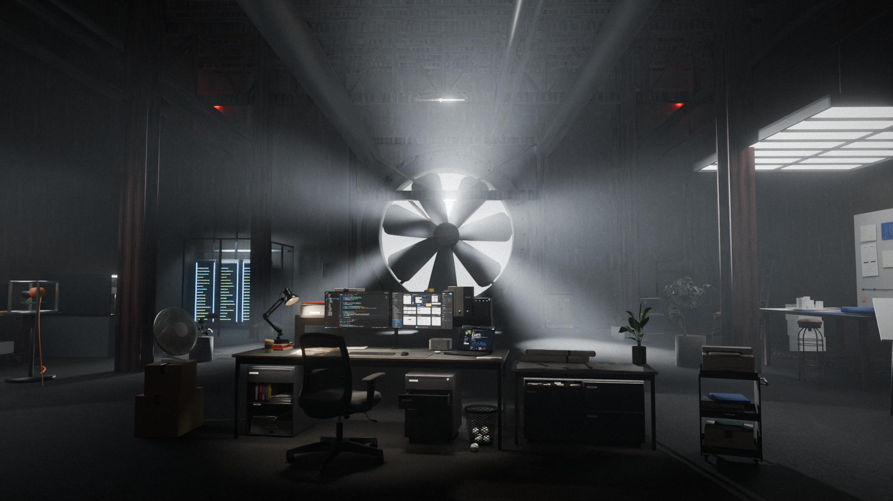
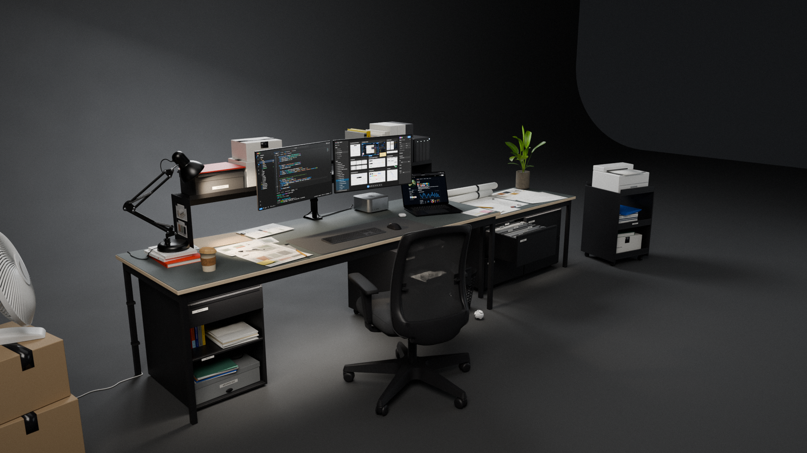

# Studio : le site

Le hero du futur site du studio : un labo souterrain en 3D, modélisé et rendu dans Blender, entièrement piloté par des scripts Python. Aucune scène n'est enregistrée à la main : les scripts sont la source.



## Le coin bureau (terminé)

Le premier coin du labo est construit élément par élément : bureau, rangements, chaise, poste, lampe, contenu des rangements, papiers, objets, sol, décor autour, câbles. Chaque document lisible dans le décor (papiers, écrans, emballages, couvertures) est une vraie page, conçue pour des clients et des marques fictifs.



- **La vidéo de la construction :** chaque objet apparaît en fil de fer, se modélise, passe en argile, se colorise puis se texture, sur la grille claire de Blender. Elle dure 74 s, tourne en boucle, et existe en version ordinateur et en version téléphone.
  - [`ordinateur-1920x1080.mp4`](hero/bureau/video/pour-le-site/ordinateur-1920x1080.mp4)
  - [`telephone-608x1080.mp4`](hero/bureau/video/pour-le-site/telephone-608x1080.mp4)
- **Les coulisses :** des captures de la scène dans Blender, avec et sans l'interface (`hero/bureau/coulisses/`).
- **La synthèse :** tout ce qui a été retenu, sur une seule page (`hero/synthese/synthese.png`).

## Le dossier

Le guide complet est [`Lis-moi.md`](Lis-moi.md) : la structure, les choix retenus, la façon de refaire chaque rendu.

```
hero/synthese/   la synthèse
hero/labo/       le décor du labo (la suite)
hero/bureau/     le coin bureau : rendus/, coulisses/, video/, pages/, recherche/
hero/outils/     les scripts : Blender (blender/), finition, textures, contenus des papiers et des écrans
```

Il faut Blender 4.5 (lancé sans interface par les scripts `hero/outils/blender/rendus-*.sh`), Python 3 avec Pillow et numpy, ffmpeg, et Node avec Playwright pour les captures.

## Ce qui n'est pas dans le dépôt

- **Les modèles 3D et textures de tiers** (`hero/outils/assets/`) : Sketchfab sous CC BY et Poly Haven sous CC0. Les auteurs, les liens et les licences sont dans [`hero/credits.md`](hero/credits.md).
- **Les images d'inspiration et de recherche** (Pinterest et le web) : les fichiers `sources.json` gardent leurs liens.
- **Le rendu de la sculpture de Leandre Cristòfol :** le scan est sous CC BY, mais l'œuvre est encore protégée par le droit d'auteur.
- **La scène `bureau-complet.blend` (112 Mo) et les rendus bruts :** les scripts les régénèrent.
